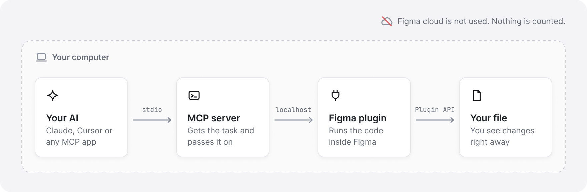

<picture>
  <source media="(prefers-color-scheme: dark)" srcset="assets/banner-dark.png">
  
</picture>

Your AI's code runs in a local plugin inside the open file. Figma's cloud is not used, so nothing is counted.

<picture>
  <source media="(prefers-color-scheme: dark)" srcset="assets/features-dark.png">
  
</picture>

##  Install

Needs Node.js 18+ and the Figma desktop app.

macOS / Linux

```sh
curl -fsSL https://raw.githubusercontent.com/oneuse1337/fuck-figma-mcp/main/install.sh | bash
```

Windows

```powershell
irm https://raw.githubusercontent.com/oneuse1337/fuck-figma-mcp/main/install.ps1 | iex
```

Then in Figma:

1. **Plugins → Development → Import plugin from manifest…** → `~/.fuck-figma-mcp/plugin/manifest.json`
2. **Plugins → Development → fuck-figma-mcp** in the file you want the AI to edit.

Run the command again to update.

##  How it works

<picture>
  <source media="(prefers-color-scheme: dark)" srcset="assets/how-it-works-dark.png">
  
</picture>
