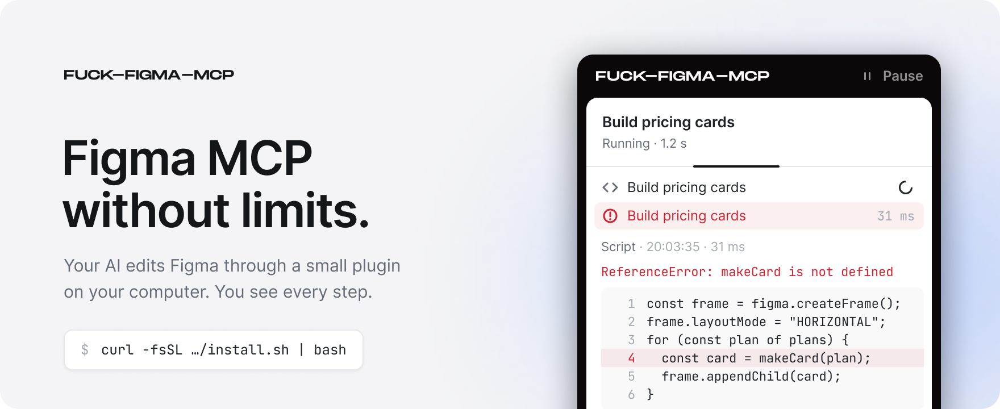

<picture>
  <source media="(prefers-color-scheme: dark)" srcset="assets/banner-dark.png">
  
</picture>

Your AI's code runs in a local plugin inside the open file. Figma's cloud is not used, so you don't have the same limits as the official Figma MCP.

##  Install

Needs Node.js 18+ and the Figma desktop app.

macOS / Linux

```sh
curl -fsSL https://raw.githubusercontent.com/oneuse1337/fuck-figma-mcp/main/install.sh | bash
```

Windows

```powershell
irm https://raw.githubusercontent.com/oneuse1337/fuck-figma-mcp/main/install.ps1 | iex
```

Then in Figma:

1. **Plugins > Development > Import plugin from manifest…** > `~/.fuck-figma-mcp/plugin/manifest.json`
2. **Plugins > Development > fuck-figma-mcp** the file in which your AI agent will operate

<div align="center">
<sub>Not made by Figma. Figma is a trademark of Figma, Inc.</sub>
</div>
