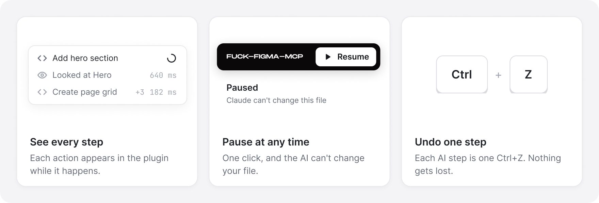

<div align="center">

<picture>
  <source media="(prefers-color-scheme: dark)" srcset="assets/banner-dark.png">
  
</picture>

<br>
<br>


<br>
<br>

**Let your AI design in Figma — as much as you want.**<br>
A small plugin runs the AI's work right inside your file. No cloud. No limits.

<br>

[Install](#install) · [How it works](#how-it-works) · [Plugin window](#plugin-window) · [Tools](#tools) · [FAQ](#faq)

</div>

<br>

## Why

The official Figma MCP sends every action to Figma's servers, and the free plan gives you only a few calls per month. When they run out, your AI stops.

**fuck-figma-mcp** works on your own computer. Your AI writes the code, and a small plugin runs it inside the Figma app. Nothing goes to Figma's servers, so there is nothing to count.

<picture>
  <source media="(prefers-color-scheme: dark)" srcset="assets/features-dark.png">
  
</picture>

<a id="install"></a>

##  Install

> [!NOTE]
> You need **[Node.js 18+](https://nodejs.org)** and the **Figma desktop app**.

**1. Run one command**

macOS · Linux

```sh
curl -fsSL https://raw.githubusercontent.com/oneuse1337/fuck-figma-mcp/main/install.sh | bash
```

Windows (PowerShell)

```powershell
irm https://raw.githubusercontent.com/oneuse1337/fuck-figma-mcp/main/install.ps1 | iex
```

The script downloads everything and connects it to Claude Code. Use another AI app? The script shows a config line for it.

**2. Add the plugin to Figma** — only once

In Figma, open **Plugins → Development → Import plugin from manifest…** and choose this file:

```text
~/.fuck-figma-mcp/plugin/manifest.json
```

**3. Start the plugin in your file**

Open **Plugins → Development → fuck-figma-mcp** and keep its window open. That's it — ask your AI to design something.

> [!TIP]
> To update, run the same command again.

<a id="how-it-works"></a>

##  How it works

<picture>
  <source media="(prefers-color-scheme: dark)" srcset="assets/how-it-works-dark.png">
  
</picture>

1. Your AI sends a piece of code to a small server on your computer.
2. The server passes it to the plugin through `localhost`.
3. The plugin runs it with the Figma Plugin API. You see the result at once.

The code never leaves your computer.

<a id="plugin-window"></a>

##  Plugin window

The plugin is not only a bridge. It shows you what the AI is doing.

| Feature | What it does |
| :-- | :-- |
| **Live steps** | Every action shows up with a short name, time and how many layers it changed. |
| **Pause** | Click **Pause**, and the AI can't touch your file until you click **Resume**. |
| **Undo** | <kbd>Ctrl</kbd> + <kbd>Z</kbd> (or <kbd>⌘</kbd> + <kbd>Z</kbd>) undoes one whole AI step, not one layer. |
| **Follow** | Turn it on, and the view moves to new layers by itself. |
| **Errors** | A failed step opens by itself and marks the line with the problem. |
| **Code** | Click any step to see its code, copy it or select the layers it made. |

<a id="compare"></a>

##  Official MCP vs this

| | Official Figma MCP | fuck-figma-mcp |
| :-- | :-: | :-: |
| Calls per month | limited by your plan | **no limit** |
| Where it runs | Figma servers | **your computer** |
| See each step live | — | ✓ |
| Pause the AI | — | ✓ |
| One undo per AI step | — | ✓ |
| Works with a closed file | ✓ | — |
| Ready-made design → code | ✓ | — |
| Search in team libraries | ✓ | — |

> [!IMPORTANT]
> For editing designs, both do the same thing: they run Figma Plugin API code in your file. The official one also has cloud extras. If you only need your AI to draw and edit, you don't need them.

<a id="tools"></a>

##  Tools

| Tool | What it does |
| :-- | :-- |
| `figma_run` | Runs Plugin API code in your file. `await` works, and what you `return` comes back as JSON. The `label` is shown in the plugin. |
| `figma_screenshot` | Makes a PNG of a layer or the whole page, so the AI can check its work. |
| `figma_status` | Shows which files have the plugin running. |

<details>
<summary><b>Use it without an AI app</b></summary>

<br>

```sh
cd ~/.fuck-figma-mcp
node run.mjs status                        # files with the plugin
node run.mjs exec code.js                  # run a script
node run.mjs shot <nodeId|-> out.png       # save a screenshot
```

`FIGMA_LABEL="My step"` sets the step name in the plugin.

</details>

<a id="faq"></a>

##  FAQ

<details>
<summary><b>Is it safe?</b></summary>

<br>

The server listens only on `127.0.0.1`, so other computers can't connect to it. The AI can change a file only while the plugin is open in it, and you can press **Pause** at any time.

</details>

<details>
<summary><b>Which AI apps can use it?</b></summary>

<br>

Any app with MCP support: Claude Code, Claude Desktop, Cursor, Windsurf, VS Code and others. If the script didn't find Claude Code, add this to your app's MCP config:

```json
{
  "mcpServers": {
    "fuck-figma-mcp": {
      "command": "node",
      "args": ["/home/you/.fuck-figma-mcp/server.mjs"]
    }
  }
}
```

Use your real path. The script prints it for you.

</details>

<details>
<summary><b>Why does the file need to be open?</b></summary>

<br>

The plugin lives inside the Figma app. No open file — no plugin — no changes. This is also the reason there are no limits: Figma's servers are not part of it.

</details>

<details>
<summary><b>Does it work in the browser?</b></summary>

<br>

No. Plugins from a local folder work only in the Figma desktop app.

</details>

<details>
<summary><b>Can I use two AI apps at the same time?</b></summary>

<br>

Yes. The first one starts the bridge, the others connect to it.

</details>

<details>
<summary><b>Does it work in FigJam?</b></summary>

<br>

Yes. Start the plugin in a FigJam board the same way.

</details>

<a id="develop"></a>

##  Change the plugin

The plugin window is made from `plugin/src/ui.html`. After you change it, build it again:

```sh
npm run build
```

This puts the fonts from `plugin/src/fonts` inside `plugin/ui.html`.

<br>

<div align="center">
<sub>Not made by Figma. Figma is a trademark of Figma, Inc.</sub>
</div>
